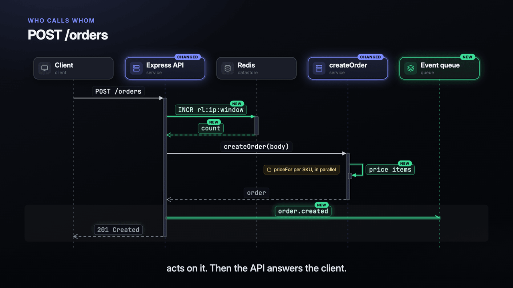
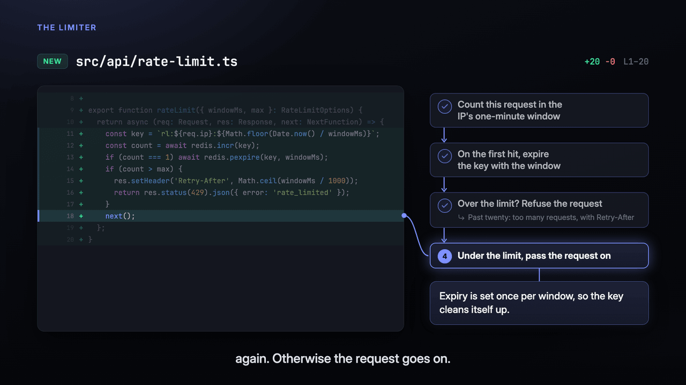
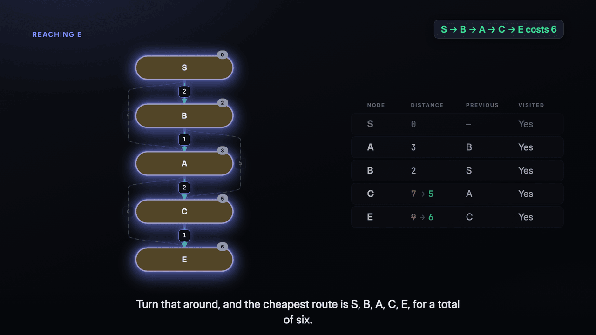
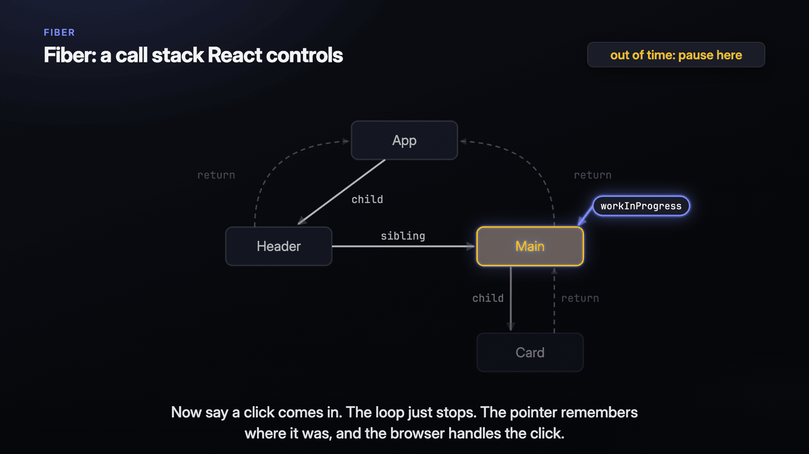
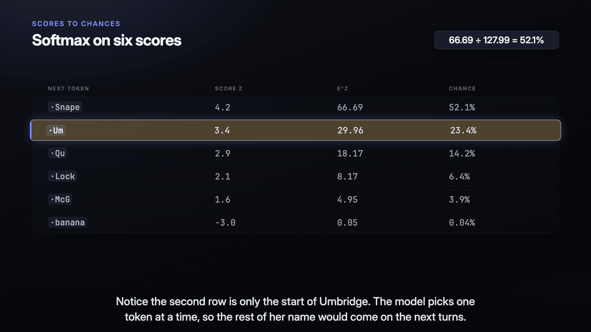

<p align="center">
  
</p>

<h1 align="center">Mister Cast (<code>mr-cast</code>)</h1>

<p align="center">
  Turn a branch, or something Claude Code explained, into a narrated, animated video.
</p>

<p align="center">
  <a href="https://www.npmjs.com/package/@shiyuphan/mr-cast"></a>
  <a href="https://github.com/phanshiyu/mr-cast/actions/workflows/ci.yml"></a>
  <a href="LICENSE"></a>
  <a href="package.json"></a>
</p>

mr-cast is a command-line tool and a Claude Code skill. Ask Claude for a video of your branch, or of something it just explained. Claude decides what the video covers and how to show it, and writes a storyboard. mr-cast gives Claude the scene types, a voice and a validator, and plays the storyboard as a narrated video in your browser or renders it to an MP4. The voice and the render run on your machine, with no cloud service.

## What it looks like

<p align="center">
  
  
</p>

Two scenes from [`examples/demo`](examples/demo), a walkthrough of a rate limit change ([watch the video](https://github.com/phanshiyu/mr-cast/releases/latest/download/demo.mp4)). A video moves through diagrams and code while the voice explains it, and lights each part as the voice reaches it.

Worked examples explain an idea with real numbers, such as Dijkstra's shortest path, React's two trees and how a GPT picks the next word:

<p align="center">
  
  
  
</p>

The [gallery](docs/gallery.md) has each example's still, storyboard and video, and a short demo of every scene type.

## Install

You need Node 22.12 or newer on macOS or Linux, and [Claude Code](https://code.claude.com).

```bash
npm install -g @shiyuphan/mr-cast
mr-cast install-skill
mr-cast --version
```

`install-skill` adds the `mr-cast`, `mr-cast-prune` and `mr-cast-upgrade` skills to Claude Code. `pnpm add -g @shiyuphan/mr-cast` works too.

## Quick start

1. Open Claude Code in a git repository, on a branch with changes.
2. Type `/mr-cast`, or ask Claude for "a video of this branch".
3. Watch the video in the browser tab that opens.

After Claude explains something, ask it to "animate that" to get a video of the explanation instead. To get a file, ask for an MP4.

## Features

- Videos of a branch's diff, or of an explanation with no diff behind it.
- A quick diagram video, a full walkthrough, or an MP4 with chapter markers and subtitles.
- A pre-read for a reviewer: diagrams only, with no code on screen, ending on the order in which to read the code.
- A review mode that flags bugs and risks on the lines that hold them and writes them to `review.md`.
- 20 scene types, among them graphs, sequence diagrams, state machines, code with line-by-line steps, arrays, memory, timelines and terminals.
- `mr-cast validate` checks that the storyboard renders, that every text fits, and that what lights up matches the words.
- An offline voice, [Kitten TTS](https://github.com/KittenML/KittenTTS) by default or [Kokoro](https://huggingface.co/hexgrad/Kokoro-82M), and a local render ([Remotion](https://www.remotion.dev)). `mr-cast voices` lists the voices.

## Documentation

- [Use mr-cast from Claude Code](docs/guide.md): sources, quick videos, MP4s, pre-reads, review mode, cleanup and upgrades.
- [Command reference](docs/cli.md): every `mr-cast` command, runs, flags, the voice and pruning.
- [Storyboard reference](docs/storyboard.md): scene types, steps, pen marks, on-screen text and marks.
- [Gallery](docs/gallery.md): a still, a storyboard and a video of each worked example and every scene type.
- [Upgrade notes](docs/upgrading.md): what changed for storyboards and skills from older versions.
- [Design decisions](docs/adr/README.md): the architecture decision records.
- [Changelog](CHANGELOG.md).

## Contributing

Bug reports and pull requests are welcome. Read [CONTRIBUTING.md](CONTRIBUTING.md) to set up a clone and run the checks. To report a vulnerability, follow [SECURITY.md](SECURITY.md).

## License

MIT. mr-cast renders with [Remotion](https://www.remotion.dev/license), which is free for individuals and companies with up to 3 employees. Larger companies need a Remotion company license to render videos with mr-cast.
