# Gallery

<!-- Written by scripts/gallery.mjs from examples/ and skill/mr-cast/references/scenes/; edit those and rerun it. -->

Worked examples, then one short demo per scene type, then a demo of the ink any stepped scene can draw. Each still is one scene at the end of its last step, from `mr-cast still`. Each video is the whole storyboard, rendered by CI and attached to the latest release.

## Examples

### Binary search

Why a sorted list can be searched in a handful of looks.

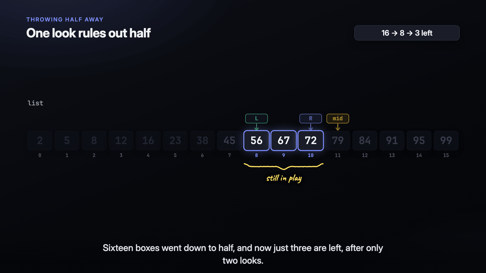

Storyboard: [examples/algorithms/binary-search/storyboard.json](../examples/algorithms/binary-search/storyboard.json). Video: [algorithms-binary-search.mp4](https://github.com/phanshiyu/mr-cast/releases/latest/download/algorithms-binary-search.mp4).

### Dijkstra's shortest path

Pick the cheapest place, then look for shortcuts.

Storyboard: [examples/algorithms/dijkstra/storyboard.json](../examples/algorithms/dijkstra/storyboard.json). Video: [algorithms-dijkstra.mp4](https://github.com/phanshiyu/mr-cast/releases/latest/download/algorithms-dijkstra.mp4).

### Hash tables

Turning a key into an address.

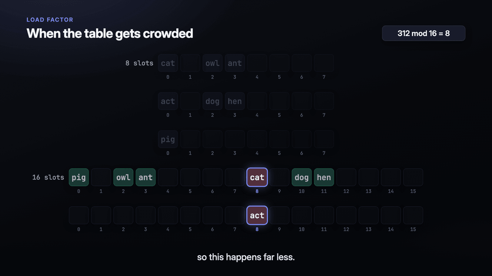

Storyboard: [examples/algorithms/hash-table/storyboard.json](../examples/algorithms/hash-table/storyboard.json). Video: [algorithms-hash-table.mp4](https://github.com/phanshiyu/mr-cast/releases/latest/download/algorithms-hash-table.mp4).

### Merge sort

Split the list to single items, then zip them back in order.

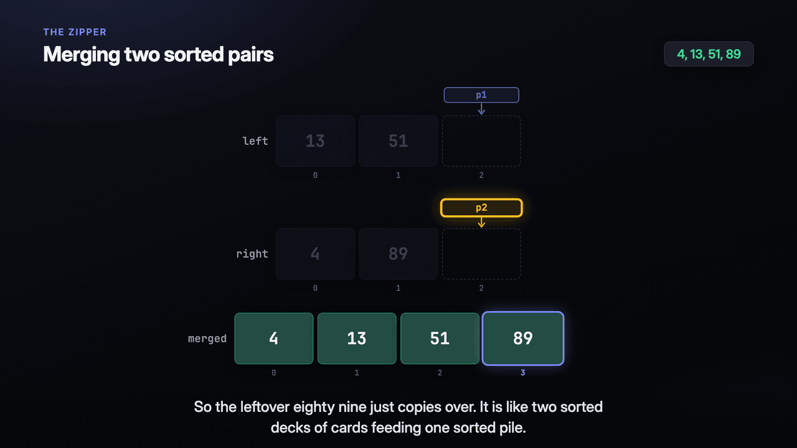

Storyboard: [examples/algorithms/merge-sort/storyboard.json](../examples/algorithms/merge-sort/storyboard.json). Video: [algorithms-merge-sort.mp4](https://github.com/phanshiyu/mr-cast/releases/latest/download/algorithms-merge-sort.mp4).

### Quicksort

Pick a pivot, split around it, repeat on each side.

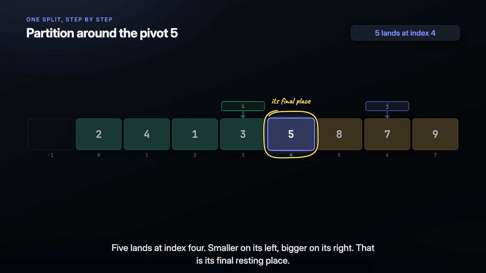

Storyboard: [examples/algorithms/quicksort/storyboard.json](../examples/algorithms/quicksort/storyboard.json). Video: [algorithms-quicksort.mp4](https://github.com/phanshiyu/mr-cast/releases/latest/download/algorithms-quicksort.mp4).

### Why Uber cut the world into hexagons

From map shapes to one number per place.

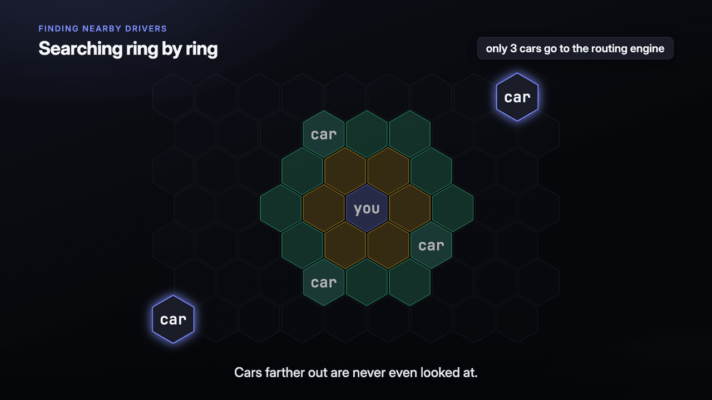

Storyboard: [examples/architecture/h3/storyboard.json](../examples/architecture/h3/storyboard.json). Video: [architecture-h3.mp4](https://github.com/phanshiyu/mr-cast/releases/latest/download/architecture-h3.mp4).

### How OAuth 2.0 actually works

Letting an app into your photos without giving it your password.

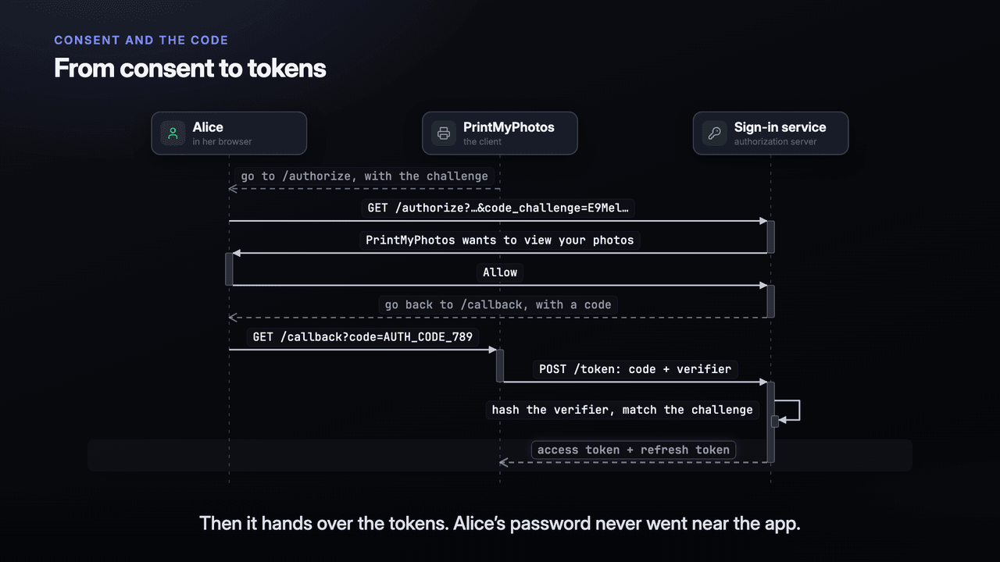

Storyboard: [examples/architecture/oauth/storyboard.json](../examples/architecture/oauth/storyboard.json). Video: [architecture-oauth.mp4](https://github.com/phanshiyu/mr-cast/releases/latest/download/architecture-oauth.mp4).

### How React works under the hood

From JSX to objects, the Fiber tree, and the two phases of an update.

Storyboard: [examples/architecture/react/storyboard.json](../examples/architecture/react/storyboard.json). Video: [architecture-react.mp4](https://github.com/phanshiyu/mr-cast/releases/latest/download/architecture-react.mp4).

### Designing YouTube at scale

From a 4 GB upload to a video that plays on any screen.

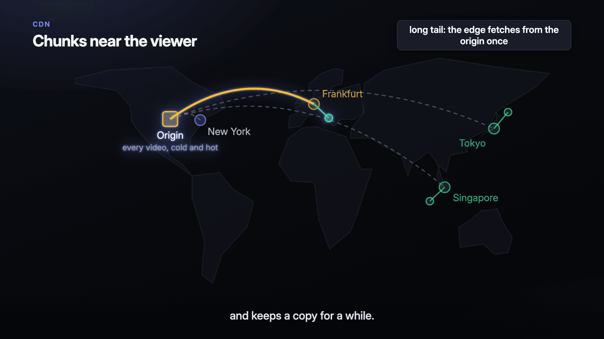

Storyboard: [examples/architecture/youtube/storyboard.json](../examples/architecture/youtube/storyboard.json). Video: [architecture-youtube.mp4](https://github.com/phanshiyu/mr-cast/releases/latest/download/architecture-youtube.mp4).

### How Bitcoin works

Building digital money from a shared list.

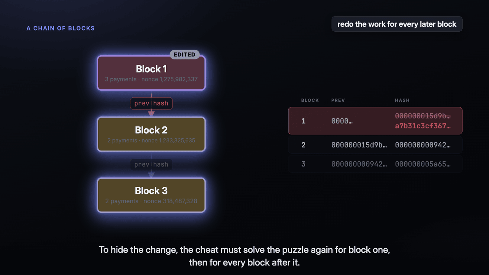

Storyboard: [examples/explain/bitcoin/storyboard.json](../examples/explain/bitcoin/storyboard.json). Video: [explain-bitcoin.mp4](https://github.com/phanshiyu/mr-cast/releases/latest/download/explain-bitcoin.mp4).

### How a GPT picks the next word

From text to tokens to chances, one token at a time.

Storyboard: [examples/explain/gpt/storyboard.json](../examples/explain/gpt/storyboard.json). Video: [explain-gpt.mp4](https://github.com/phanshiyu/mr-cast/releases/latest/download/explain-gpt.mp4).

## Scene types

### array

One or more rows of cells with their indexes, named pointers above and shaded ranges below, or a hex grid. Each step changes a value, moves a pointer or tints cells, then lights what it is about.

Storyboard: [examples/primitives/array/storyboard.json](../examples/primitives/array/storyboard.json). Video: [primitives-array.mp4](https://github.com/phanshiyu/mr-cast/releases/latest/download/primitives-array.mp4). Reference: [array.md](../skill/mr-cast/references/scenes/array.md).

### chart

A bar or line chart of real numbers, with a change badge on each label when there are two series.

Storyboard: [examples/primitives/chart/storyboard.json](../examples/primitives/chart/storyboard.json). Video: [primitives-chart.mp4](https://github.com/phanshiyu/mr-cast/releases/latest/download/primitives-chart.mp4). Reference: [chart.md](../skill/mr-cast/references/scenes/chart.md).

### code

The lines of one hunk or snippet, the rest dimmed, walked a range at a time, with an optional step diagram beside them.

Storyboard: [examples/primitives/code/storyboard.json](../examples/primitives/code/storyboard.json). Video: [primitives-code.mp4](https://github.com/phanshiyu/mr-cast/releases/latest/download/primitives-code.mp4). Reference: [code.md](../skill/mr-cast/references/scenes/code.md).

### compare

Two sides in one layout, row by row. Rows that differ get an arrow between the sides, rows that match dim.

Storyboard: [examples/primitives/compare/storyboard.json](../examples/primitives/compare/storyboard.json). Video: [primitives-compare.mp4](https://github.com/phanshiyu/mr-cast/releases/latest/download/primitives-compare.mp4). Reference: [compare.md](../skill/mr-cast/references/scenes/compare.md).

### er

Tables or models with their keys and in-play fields, and lines between them with their cardinality.

Storyboard: [examples/primitives/er/storyboard.json](../examples/primitives/er/storyboard.json). Video: [primitives-er.mp4](https://github.com/phanshiyu/mr-cast/releases/latest/download/primitives-er.mp4). Reference: [er.md](../skill/mr-cast/references/scenes/er.md).

### files

The files as a tree with their line counts, and a short note beside the ones that matter.

Storyboard: [examples/primitives/files/storyboard.json](../examples/primitives/files/storyboard.json). Video: [primitives-files.mp4](https://github.com/phanshiyu/mr-cast/releases/latest/download/primitives-files.mp4). Reference: [files.md](../skill/mr-cast/references/scenes/files.md).

### flow

A row of stages, each an actor and what it does, with the data as it looks after that stage.

Storyboard: [examples/primitives/flow/storyboard.json](../examples/primitives/flow/storyboard.json). Video: [primitives-flow.mp4](https://github.com/phanshiyu/mr-cast/releases/latest/download/primitives-flow.mp4). Reference: [flow.md](../skill/mr-cast/references/scenes/flow.md).

### graph

Cards and the lines between them, laid out automatically. With `decision`, `terminal` and `step` shapes it is a flowchart. Steps can grow it, tint it, set badges, and change a table beside it.

Storyboard: [examples/primitives/graph/storyboard.json](../examples/primitives/graph/storyboard.json). Video: [primitives-graph.mp4](https://github.com/phanshiyu/mr-cast/releases/latest/download/primitives-graph.mp4). Reference: [graph.md](../skill/mr-cast/references/scenes/graph.md).

### intent

An older scene type, drawn as a [text](#text) scene; see [text.md](../skill/mr-cast/references/scenes/text.md).

### layers

Bands stacked top to bottom in their real order, each holding a few cards, with a token that carries a request down and its reply back up.

Storyboard: [examples/primitives/layers/storyboard.json](../examples/primitives/layers/storyboard.json). Video: [primitives-layers.mp4](https://github.com/phanshiyu/mr-cast/releases/latest/download/primitives-layers.mp4). Reference: [layers.md](../skill/mr-cast/references/scenes/layers.md).

### memory

Call frames with their variables on the left, objects on the right, and an arrow for every reference.

Storyboard: [examples/primitives/memory/storyboard.json](../examples/primitives/memory/storyboard.json). Video: [primitives-memory.mp4](https://github.com/phanshiyu/mr-cast/releases/latest/download/primitives-memory.mp4). Reference: [memory.md](../skill/mr-cast/references/scenes/memory.md).

### mermaid

A static Mermaid diagram, for a shape no other primitive draws.

Storyboard: [examples/primitives/mermaid/storyboard.json](../examples/primitives/mermaid/storyboard.json). Video: [primitives-mermaid.mp4](https://github.com/phanshiyu/mr-cast/releases/latest/download/primitives-mermaid.mp4). Reference: [mermaid.md](../skill/mr-cast/references/scenes/mermaid.md).

### reading

The order in which to read the code, each item with its file, lines and what to check there.

Storyboard: [examples/primitives/reading/storyboard.json](../examples/primitives/reading/storyboard.json). Video: [primitives-reading.mp4](https://github.com/phanshiyu/mr-cast/releases/latest/download/primitives-reading.mp4). Reference: [reading.md](../skill/mr-cast/references/scenes/reading.md).

### review

A recap of what looks wrong, grouped by severity, each with its file and line.

Storyboard: [examples/primitives/review/storyboard.json](../examples/primitives/review/storyboard.json). Video: [primitives-review.mp4](https://github.com/phanshiyu/mr-cast/releases/latest/download/primitives-review.mp4). Reference: [review.md](../skill/mr-cast/references/scenes/review.md).

### sequence

Participants across the top and messages down the page in time order: calls, replies and fire-and-forget messages.

Storyboard: [examples/primitives/sequence/storyboard.json](../examples/primitives/sequence/storyboard.json). Video: [primitives-sequence.mp4](https://github.com/phanshiyu/mr-cast/releases/latest/download/primitives-sequence.mp4). Reference: [sequence.md](../skill/mr-cast/references/scenes/sequence.md).

### state

The statuses a thing can be in and the moves between them, with the start marked and the end states double-bordered.

Storyboard: [examples/primitives/state/storyboard.json](../examples/primitives/state/storyboard.json). Video: [primitives-state.mp4](https://github.com/phanshiyu/mr-cast/releases/latest/download/primitives-state.mp4). Reference: [state.md](../skill/mr-cast/references/scenes/state.md).

### svg

A drawing in SVG markup that steps light, colour, show and hide by element id: a map, a tiling, a geometric figure, points on a plane.

Storyboard: [examples/primitives/svg/storyboard.json](../examples/primitives/svg/storyboard.json). Video: [primitives-svg.mp4](https://github.com/phanshiyu/mr-cast/releases/latest/download/primitives-svg.mp4). Reference: [svg.md](../skill/mr-cast/references/scenes/svg.md).

### table

Rows and columns of facts, with a changed value drawn as the old one struck through beside the new. Steps can add rows, change cells and tint rows.

Storyboard: [examples/primitives/table/storyboard.json](../examples/primitives/table/storyboard.json). Video: [primitives-table.mp4](https://github.com/phanshiyu/mr-cast/releases/latest/download/primitives-table.mp4). Reference: [table.md](../skill/mr-cast/references/scenes/table.md).

### terminal

A shell window where commands type out and their output appears, a failing exit tinted red.

Storyboard: [examples/primitives/terminal/storyboard.json](../examples/primitives/terminal/storyboard.json). Video: [primitives-terminal.mp4](https://github.com/phanshiyu/mr-cast/releases/latest/download/primitives-terminal.mp4). Reference: [terminal.md](../skill/mr-cast/references/scenes/terminal.md).

### tests

A matrix of the situations the code meets against the outcomes it promises, with the tests that check each cell, the promises nothing checks, and the situations no test tries.

Storyboard: [examples/primitives/tests/storyboard.json](../examples/primitives/tests/storyboard.json). Video: [primitives-tests.mp4](https://github.com/phanshiyu/mr-cast/releases/latest/download/primitives-tests.mp4). Reference: [tests.md](../skill/mr-cast/references/scenes/tests.md).

### text

Words as the picture: one lead drawn as its field says (a headline, a question, a number, a term or a quote), a kicker above it, a note under it, and a list or two sides under that. Steps rewrite, show and hide its parts.

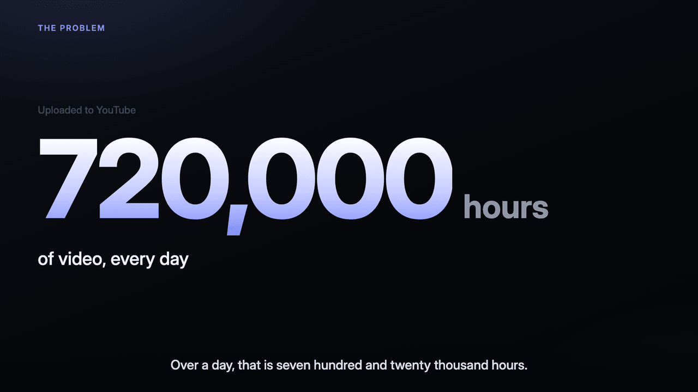

Storyboard: [examples/primitives/text/storyboard.json](../examples/primitives/text/storyboard.json). Video: [primitives-text.mp4](https://github.com/phanshiyu/mr-cast/releases/latest/download/primitives-text.mp4). Reference: [text.md](../skill/mr-cast/references/scenes/text.md).

### timeline

Events at their real times on one axis, with spans for waits and windows, and a playhead that moves as the steps go.

Storyboard: [examples/primitives/timeline/storyboard.json](../examples/primitives/timeline/storyboard.json). Video: [primitives-timeline.mp4](https://github.com/phanshiyu/mr-cast/releases/latest/download/primitives-timeline.mp4). Reference: [timeline.md](../skill/mr-cast/references/scenes/timeline.md).

## On every scene

### camera

A camera on any stepped scene: a step's `camera` zooms and pans to what it names, and stays there until a later step's camera, or `"all"` pulls back to the whole scene.

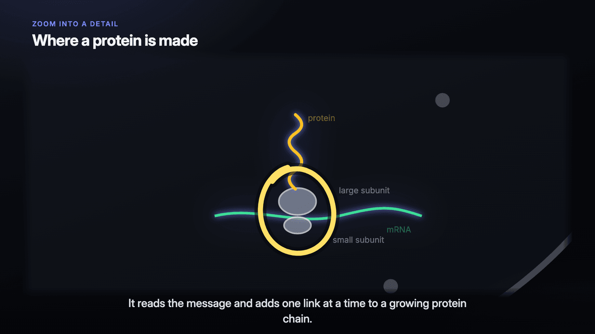

Storyboard: [examples/primitives/camera/storyboard.json](../examples/primitives/camera/storyboard.json). Video: [primitives-camera.mp4](https://github.com/phanshiyu/mr-cast/releases/latest/download/primitives-camera.mp4). Reference: [camera.md](../skill/mr-cast/references/camera.md).

### ink

A pen that writes and draws on any stepped scene, as on a whiteboard. A step's `draw` lists what to draw; each item is written on as the voice reaches its cue words and stays until a later step's `erase`.

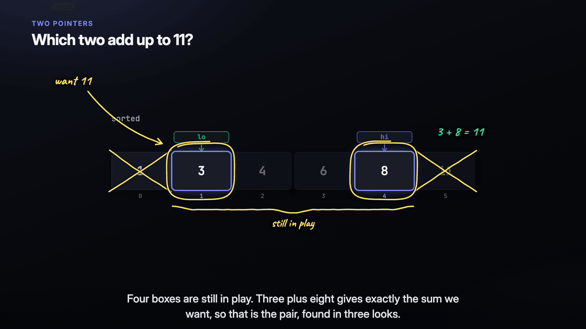

Storyboard: [examples/primitives/ink/storyboard.json](../examples/primitives/ink/storyboard.json). Video: [primitives-ink.mp4](https://github.com/phanshiyu/mr-cast/releases/latest/download/primitives-ink.mp4). Reference: [ink.md](../skill/mr-cast/references/ink.md).

### motion

Motion on an `svg` scene: a step's `move` slides, turns and scales elements, `trace` draws lines on from their start, `morph` turns one path into the shape of another, and `class="flow"` marches dashes along a line.

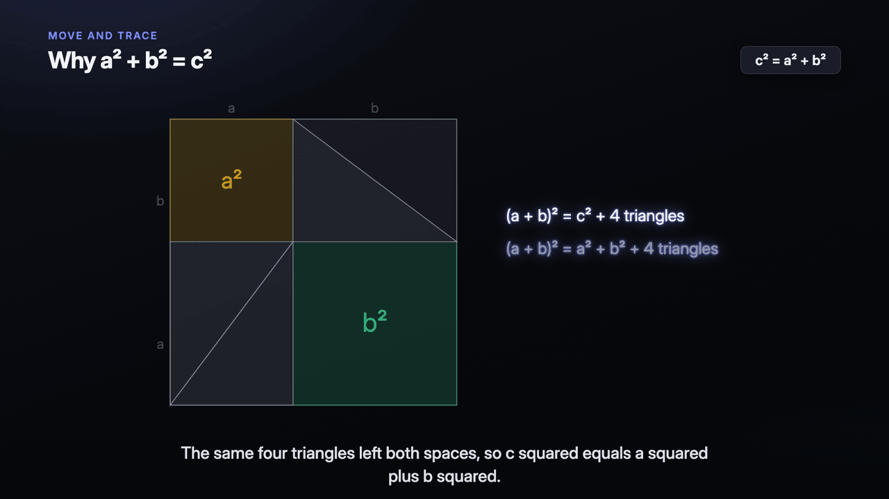

Storyboard: [examples/primitives/motion/storyboard.json](../examples/primitives/motion/storyboard.json). Video: [primitives-motion.mp4](https://github.com/phanshiyu/mr-cast/releases/latest/download/primitives-motion.mp4). Reference: [motion.md](../skill/mr-cast/references/motion.md).
