# Scene gallery

<!-- Written by scripts/gallery.mjs from examples/primitives/ and skill/mr-cast/references/scenes/; edit those and rerun it. -->

One short demo per scene type. Each still is the demo's `<type>` scene at the end of its last step, from `mr-cast still`. Each video is the whole demo, rendered by CI and attached to the latest release.

## array

One or more rows of cells with their indexes, named pointers above and shaded ranges below, or a hex grid. Each step changes a value, moves a pointer or tints cells, then lights what it is about.

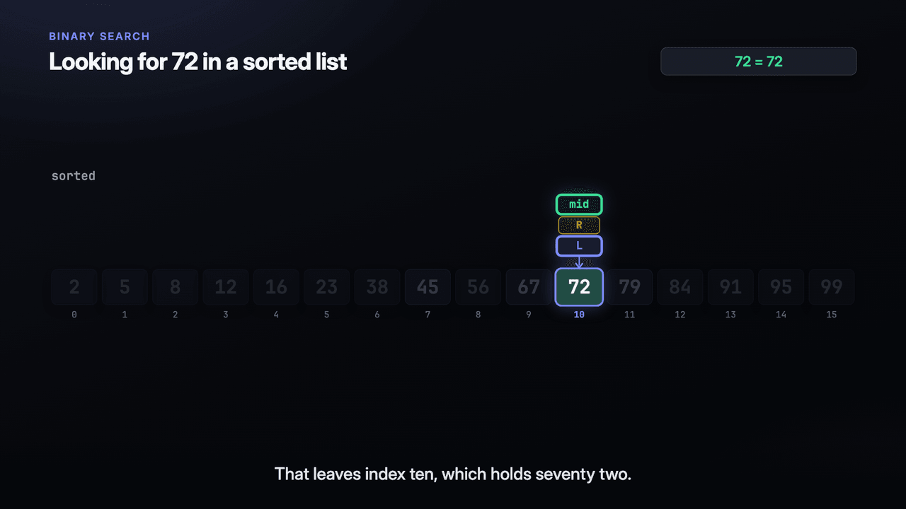

Storyboard: [examples/primitives/array/storyboard.json](../examples/primitives/array/storyboard.json). Video: [array.mp4](https://github.com/phanshiyu/mr-cast/releases/latest/download/array.mp4). Reference: [array.md](../skill/mr-cast/references/scenes/array.md).

## chart

A bar or line chart of real numbers, with a change badge on each label when there are two series.

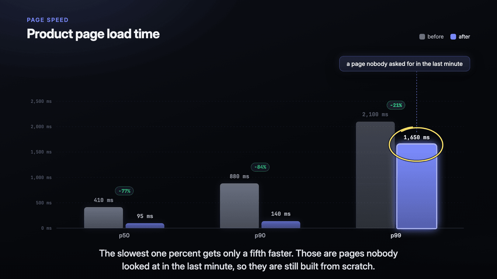

Storyboard: [examples/primitives/chart/storyboard.json](../examples/primitives/chart/storyboard.json). Video: [chart.mp4](https://github.com/phanshiyu/mr-cast/releases/latest/download/chart.mp4). Reference: [chart.md](../skill/mr-cast/references/scenes/chart.md).

## code

The lines of one hunk or snippet, the rest dimmed, walked a range at a time, with an optional step diagram beside them.

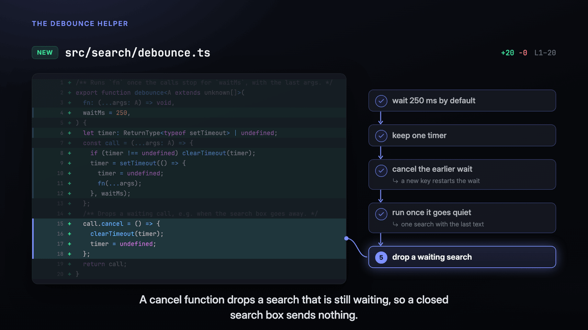

Storyboard: [examples/primitives/code/storyboard.json](../examples/primitives/code/storyboard.json). Video: [code.mp4](https://github.com/phanshiyu/mr-cast/releases/latest/download/code.mp4). Reference: [code.md](../skill/mr-cast/references/scenes/code.md).

## compare

Two sides in one layout, row by row. Rows that differ get an arrow between the sides, rows that match dim.

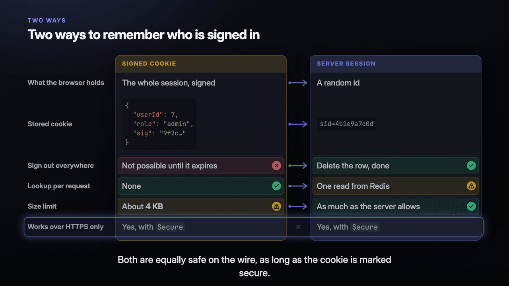

Storyboard: [examples/primitives/compare/storyboard.json](../examples/primitives/compare/storyboard.json). Video: [compare.mp4](https://github.com/phanshiyu/mr-cast/releases/latest/download/compare.mp4). Reference: [compare.md](../skill/mr-cast/references/scenes/compare.md).

## er

Tables or models with their keys and in-play fields, and lines between them with their cardinality.

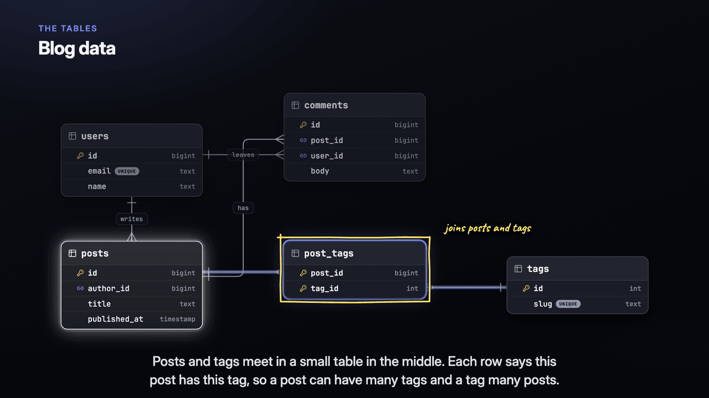

Storyboard: [examples/primitives/er/storyboard.json](../examples/primitives/er/storyboard.json). Video: [er.mp4](https://github.com/phanshiyu/mr-cast/releases/latest/download/er.mp4). Reference: [er.md](../skill/mr-cast/references/scenes/er.md).

## files

The files as a tree with their line counts, and a short note beside the ones that matter.

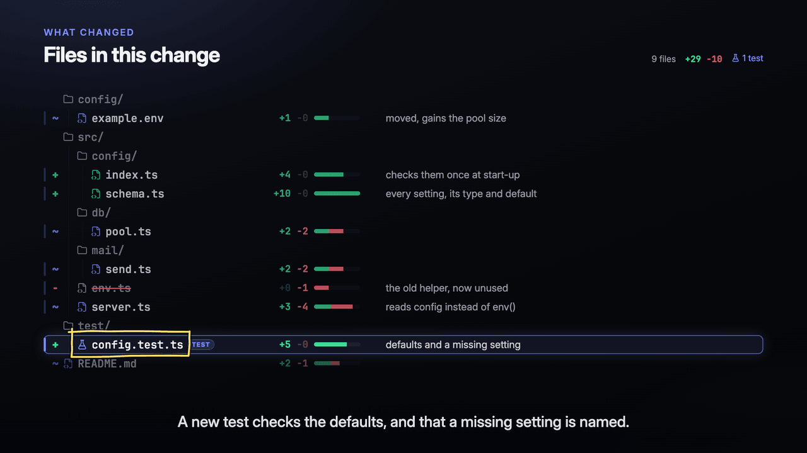

Storyboard: [examples/primitives/files/storyboard.json](../examples/primitives/files/storyboard.json). Video: [files.mp4](https://github.com/phanshiyu/mr-cast/releases/latest/download/files.mp4). Reference: [files.md](../skill/mr-cast/references/scenes/files.md).

## flow

A row of stages, each an actor and what it does, with the data as it looks after that stage.

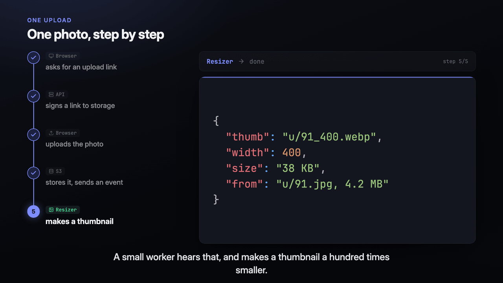

Storyboard: [examples/primitives/flow/storyboard.json](../examples/primitives/flow/storyboard.json). Video: [flow.mp4](https://github.com/phanshiyu/mr-cast/releases/latest/download/flow.mp4). Reference: [flow.md](../skill/mr-cast/references/scenes/flow.md).

## graph

Cards and the lines between them, laid out automatically. With `decision`, `terminal` and `step` shapes it is a flowchart. Steps can grow it, tint it, set badges, and change a table beside it.

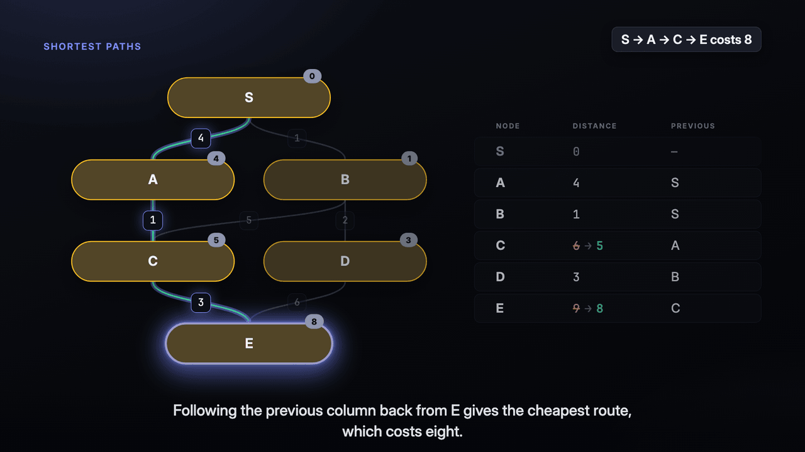

Storyboard: [examples/primitives/graph/storyboard.json](../examples/primitives/graph/storyboard.json). Video: [graph.mp4](https://github.com/phanshiyu/mr-cast/releases/latest/download/graph.mp4). Reference: [graph.md](../skill/mr-cast/references/scenes/graph.md).

## intent

A card with a one-line summary, an optional risk badge, and up to 6 bullets.

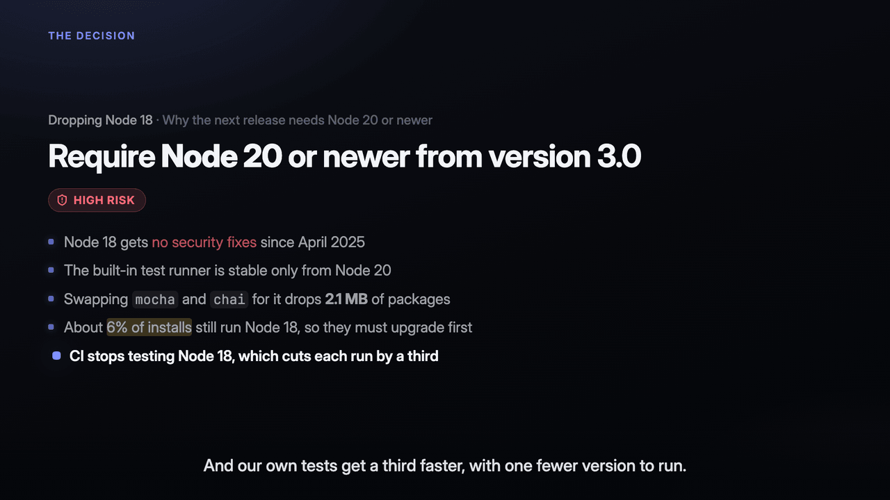

Storyboard: [examples/primitives/intent/storyboard.json](../examples/primitives/intent/storyboard.json). Video: [intent.mp4](https://github.com/phanshiyu/mr-cast/releases/latest/download/intent.mp4). Reference: [intent.md](../skill/mr-cast/references/scenes/intent.md).

## layers

Bands stacked top to bottom in their real order, each holding a few cards, with a token that carries a request down and its reply back up.

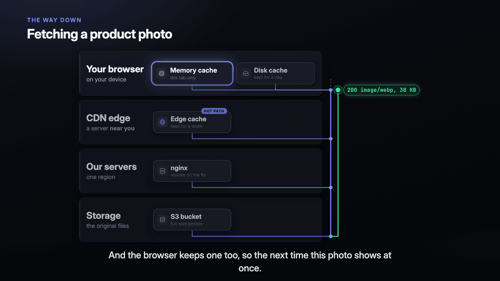

Storyboard: [examples/primitives/layers/storyboard.json](../examples/primitives/layers/storyboard.json). Video: [layers.mp4](https://github.com/phanshiyu/mr-cast/releases/latest/download/layers.mp4). Reference: [layers.md](../skill/mr-cast/references/scenes/layers.md).

## memory

Call frames with their variables on the left, objects on the right, and an arrow for every reference.

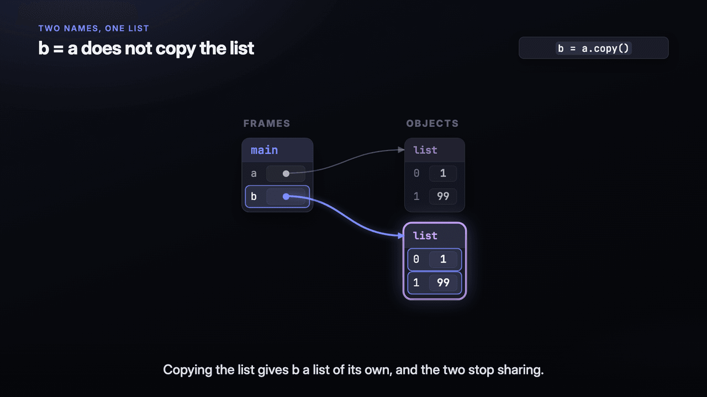

Storyboard: [examples/primitives/memory/storyboard.json](../examples/primitives/memory/storyboard.json). Video: [memory.mp4](https://github.com/phanshiyu/mr-cast/releases/latest/download/memory.mp4). Reference: [memory.md](../skill/mr-cast/references/scenes/memory.md).

## mermaid

A static Mermaid diagram, for a shape no other primitive draws.

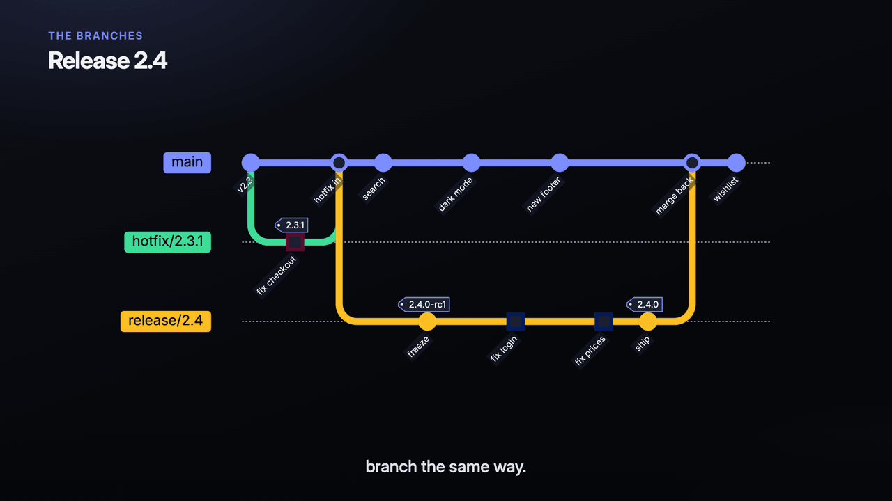

Storyboard: [examples/primitives/mermaid/storyboard.json](../examples/primitives/mermaid/storyboard.json). Video: [mermaid.mp4](https://github.com/phanshiyu/mr-cast/releases/latest/download/mermaid.mp4). Reference: [mermaid.md](../skill/mr-cast/references/scenes/mermaid.md).

## reading

The order in which to read the code, each item with its file, lines and what to check there.

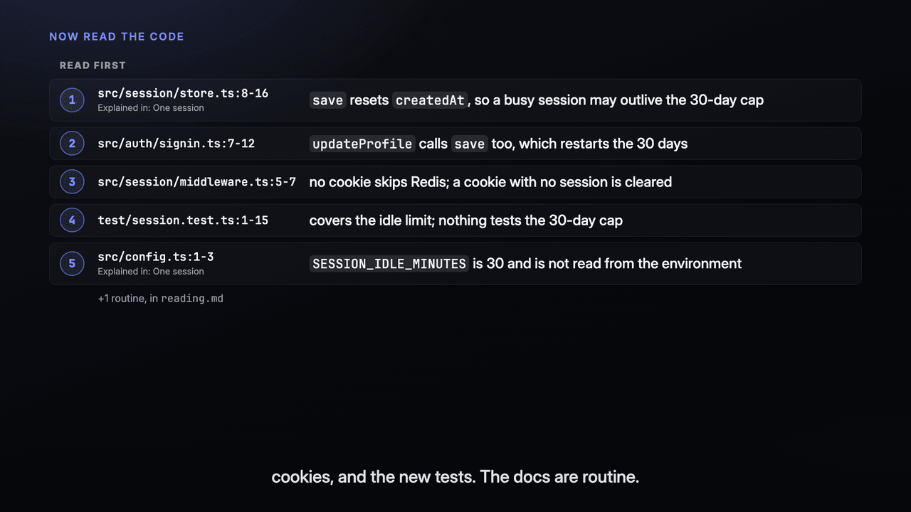

Storyboard: [examples/primitives/reading/storyboard.json](../examples/primitives/reading/storyboard.json). Video: [reading.mp4](https://github.com/phanshiyu/mr-cast/releases/latest/download/reading.mp4). Reference: [reading.md](../skill/mr-cast/references/scenes/reading.md).

## review

A recap of what looks wrong, grouped by severity, each with its file and line.

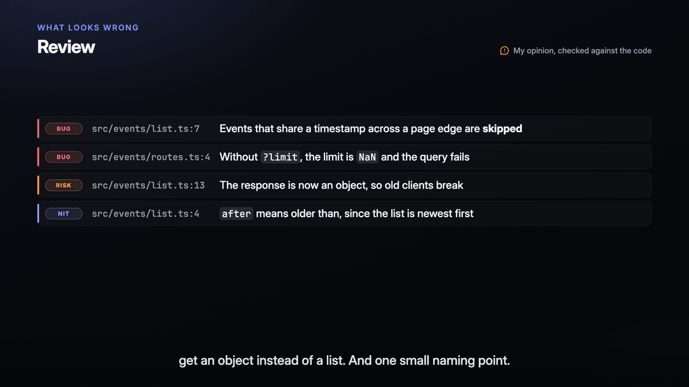

Storyboard: [examples/primitives/review/storyboard.json](../examples/primitives/review/storyboard.json). Video: [review.mp4](https://github.com/phanshiyu/mr-cast/releases/latest/download/review.mp4). Reference: [review.md](../skill/mr-cast/references/scenes/review.md).

## sequence

Participants across the top and messages down the page in time order: calls, replies and fire-and-forget messages.

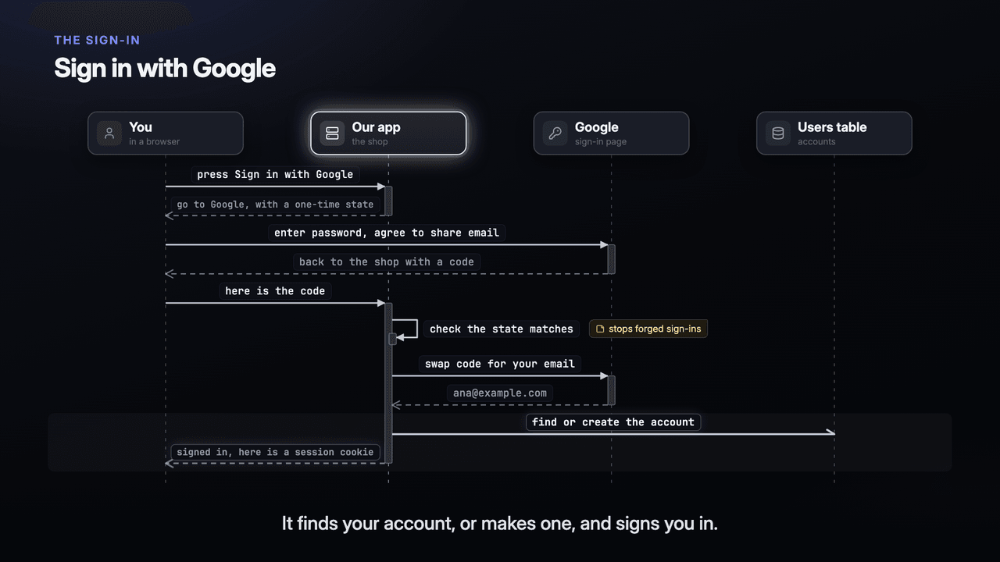

Storyboard: [examples/primitives/sequence/storyboard.json](../examples/primitives/sequence/storyboard.json). Video: [sequence.mp4](https://github.com/phanshiyu/mr-cast/releases/latest/download/sequence.mp4). Reference: [sequence.md](../skill/mr-cast/references/scenes/sequence.md).

## state

The statuses a thing can be in and the moves between them, with the start marked and the end states double-bordered.

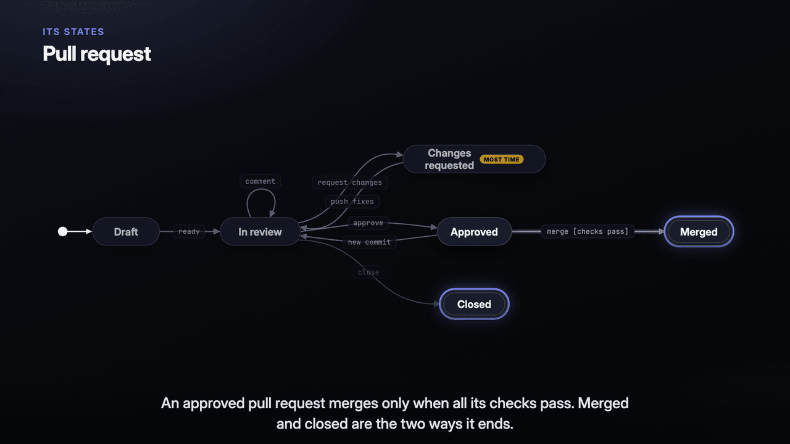

Storyboard: [examples/primitives/state/storyboard.json](../examples/primitives/state/storyboard.json). Video: [state.mp4](https://github.com/phanshiyu/mr-cast/releases/latest/download/state.mp4). Reference: [state.md](../skill/mr-cast/references/scenes/state.md).

## svg

A drawing in SVG markup that steps light, colour, show and hide by element id: a map, a tiling, a geometric figure, points on a plane.

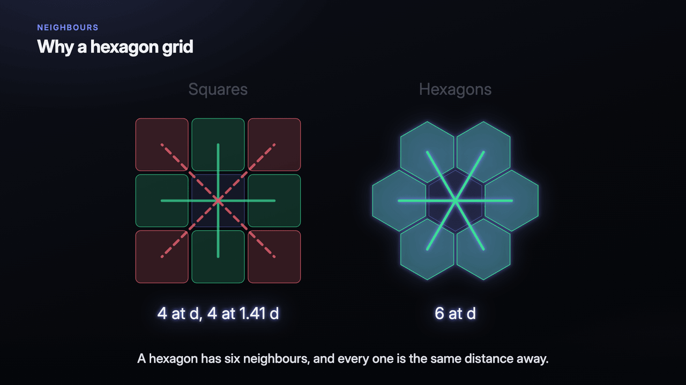

Storyboard: [examples/primitives/svg/storyboard.json](../examples/primitives/svg/storyboard.json). Video: [svg.mp4](https://github.com/phanshiyu/mr-cast/releases/latest/download/svg.mp4). Reference: [svg.md](../skill/mr-cast/references/scenes/svg.md).

## table

Rows and columns of facts, with a changed value drawn as the old one struck through beside the new. Steps can add rows, change cells and tint rows.

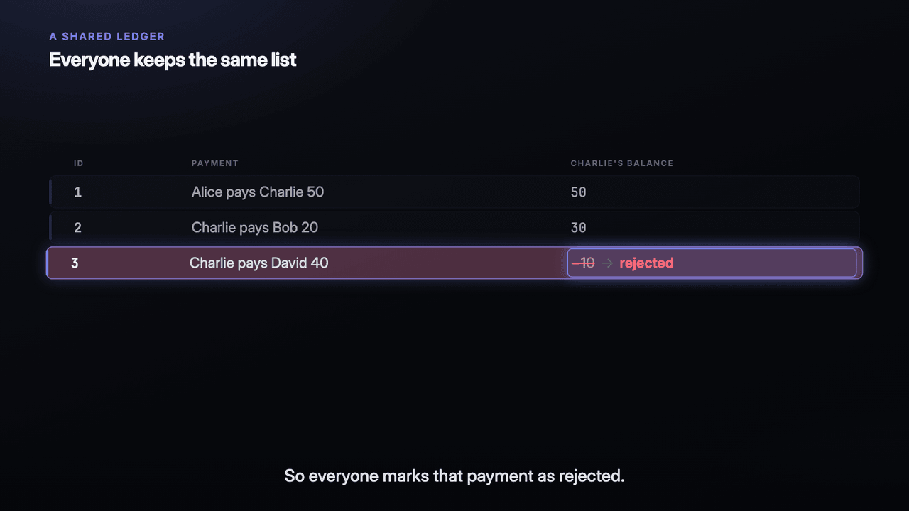

Storyboard: [examples/primitives/table/storyboard.json](../examples/primitives/table/storyboard.json). Video: [table.mp4](https://github.com/phanshiyu/mr-cast/releases/latest/download/table.mp4). Reference: [table.md](../skill/mr-cast/references/scenes/table.md).

## terminal

A shell window where commands type out and their output appears, a failing exit tinted red.

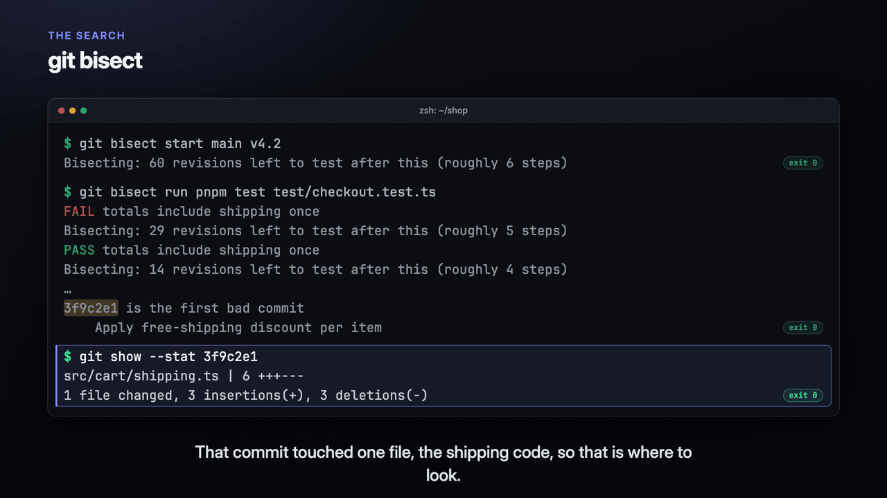

Storyboard: [examples/primitives/terminal/storyboard.json](../examples/primitives/terminal/storyboard.json). Video: [terminal.mp4](https://github.com/phanshiyu/mr-cast/releases/latest/download/terminal.mp4). Reference: [terminal.md](../skill/mr-cast/references/scenes/terminal.md).

## tests

Each test beside what it proves in plain words, and the gaps nothing tests listed apart.

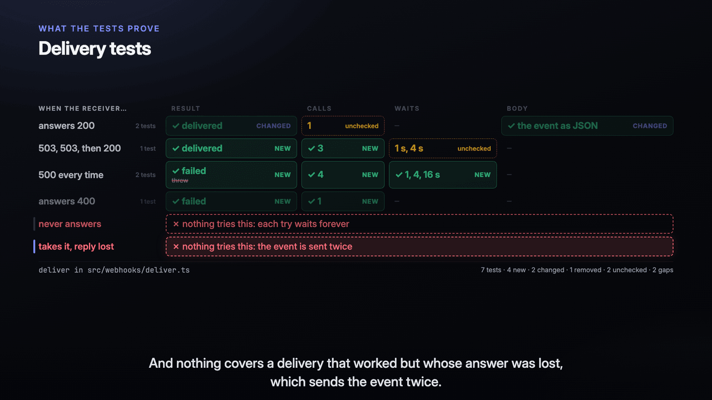

Storyboard: [examples/primitives/tests/storyboard.json](../examples/primitives/tests/storyboard.json). Video: [tests.mp4](https://github.com/phanshiyu/mr-cast/releases/latest/download/tests.mp4). Reference: [tests.md](../skill/mr-cast/references/scenes/tests.md).

## timeline

Events at their real times on one axis, with spans for waits and windows, and a playhead that moves as the steps go.

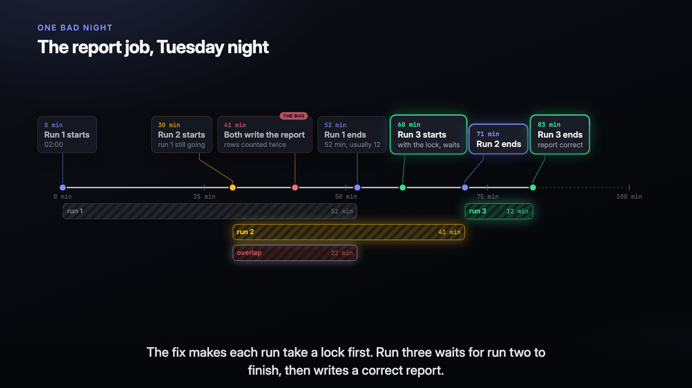

Storyboard: [examples/primitives/timeline/storyboard.json](../examples/primitives/timeline/storyboard.json). Video: [timeline.mp4](https://github.com/phanshiyu/mr-cast/releases/latest/download/timeline.mp4). Reference: [timeline.md](../skill/mr-cast/references/scenes/timeline.md).
