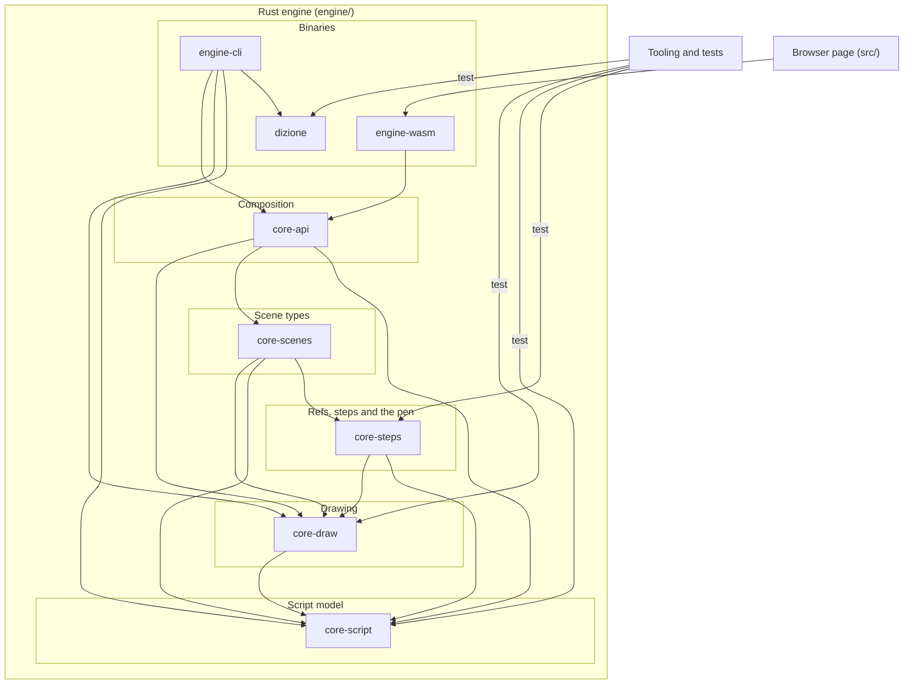

# mr-cast engine

The renderer for mr-cast videos. It reads the props `bin/lib/engine.mjs` writes (storyboard, hunks, voice timing, images), draws every frame on the CPU, and encodes and writes the MP4 itself (no ffmpeg; see
docs/adr/0044-encode-in-the-engine.md).

```
engine/
  Cargo.toml             workspace (core, cli, wasm, dizione); rustfmt.toml: max_width 120
  assets/fonts/          Inter (variable, wght 400-800, opsz 14-32), JetBrains Mono (variable), Caveat 600, as TTF, with OFL texts
                         and the fallbacks for glyphs they lack, as Chrome falls back per character: Inter and
                         JetBrains Mono beyond Latin (Greek, Cyrillic, arrows, math, modifier letters), Noto Sans Symbols (variable),
                         Noto Sans Math and Noto Sans Symbols 2, each subset to its symbol blocks with pyftsubset
  core/                  mrc_core: no threads, files or processes; builds for wasm32-unknown-unknown
    data/                font-metrics.json, slots.json, lucide.json (icons) and world-110m/50m.json (map outlines), written
                         by scripts/engine-dump.mjs from the JS and TS
    src/
      lib.rs             Project, build_frame, render_frame (and _with/_into variants for reused buffers)
      model.rs           Props: storyboard (scenes kept as JSON, findings), hunks, voiceover, highlight (syntax colours),
                         icons (the storyboard's Lucide icons)
      timing.rs          shared/timing.mjs + steps.mjs + voice lookup: segments, durations, spoken_at
      speech.rs, markup.rs   shared/speech.mjs and shared/markup.mjs
      textfit.rs         shared/textfit.mjs over the measured advances: fit_text, fit_text_at, fit_lines, measure, Slot::named
      focus.rs           shared/focus.mjs: line refs and focus ranges of code scenes
      anim.rs            Remotion's interpolate, spring (incl. durationInFrames), Easing.bezier/out(cubic)
      steps.rs           src/utils/spotlight.ts: Spotlight/Emphasis, spotlight_starts, current_step, step_move, step_spring
      theme.rs           colours, SAFE, content_box, tones, code_columns
      color.rs           CSS colour parsing (hex, rgb(a), hsl)
      text.rs            fonts, swash shaping (Chrome's wght/opsz/kerning/ligatures), line metrics, baselines
      display.rs         the display list and its builder; svg_path; fingerprint (frame equality)
      raster.rs          tiny-skia for paths, hand-rolled box fills, cached glyph/shadow/glow masks, clips, layers
      icons.rs           Lucide icons as path data (data/lucide.json)
      marks/             pen marks and ink: MarkTargets, Board, ref resolution (mod.rs); their geometry (geometry.rs)
      camera.rs          shared/camera.mjs: Camera, View, frame_shot, tween_view; draws a scene's content through a view
      states.rs          shared/state-steps.mjs's walk: StateModel (ClosureModel for svg and map), walk_states,
                         StateFrame (shown, place, tint, changed)
      targets/           shared/targets.mjs: each type's resolve, step_targets, target_steps
      chrome/            backdrop, shell (chapter label, title, aside, content box, enter/exit, header_box,
                         HeaderCallout, source line), captions, fittext
      scenes/            mod.rs (registry and contract), one module per scene type, placeholder.rs
                         media.rs: what image, svg, mermaid and map share (picture downscale, resvg, svg_boxes)
    tests/js_fixtures.rs timing, speech, text fitting, springs and easings against the JS's own outputs
    tests/marks_geometry.rs  pen and ink geometry against src/utils/penGeometry.ts and inkGeometry.ts
  cli/                   mr-cast-engine: render, still, sheet, probe
    src/encode.rs        repeats, runs of frames per core, rendering and encoding in rounds, yuv420p
    src/h264.rs          OpenH264 (openh264-sys2, built from source): one encoder per run, samples as MP4 wants them
    src/aac.rs           FDK AAC (fdk-aac-sys, built from source): the voice-over as AAC-LC, and back for checks
    src/mp4.rs           the MP4 writer (faststart, VFR durations, edit lists, chapters both ways) and its reader
    src/audio.rs         the voice clips mixed at their frames, at 48 kHz
    src/voice.rs         `voice`: speaks clips with tiny-voca (dizione, then the ONNX model in tract, pure Rust), clips and
                         sentences on every core, and times each word from the model's durations
  wasm/                  mrc_wasm: the core for the browser player (wasm-bindgen); scripts/build-wasm.mjs builds wasm/pkg
  dizione/               English text to tiny-voca's phoneme tokens: a port of the dizione Python package (Apache-2.0),
                         module by module; data/ holds its tables, tests/fixtures.rs checks 7,700 sentences against
                         the Python package (DIZIONE_DATA=<the model's phonemizer/ directory>), and
                         tests/fixtures/make-phonemes.py writes them
```

## How the engine is layered

Each box imports only the boxes below it. The picture is generated from `architecture.mmd` at the repository root, and `pnpm check` fails when it goes stale (`pnpm arch:update` redraws it).

<!-- driftwall render --focus engine --short-labels -->

<!-- driftwall render end -->

## Running it

```
node scripts/engine-dump.mjs props <run dir> props.json     # the props, as bin/lib/render.mjs builds them, plus syntax colours
cargo build --release --manifest-path engine/Cargo.toml
engine/target/release/mr-cast-engine render --props props.json --out video.mp4 [--frames a..b | --scenes 1,4..12]
                                            [--media-dir <run dir>] [--encoder h264|none] [--qp 22] [--cfr yes]
                                            [--scale 0.5] [--progress yes]
engine/target/release/mr-cast-engine still --props props.json (--frame N | --scene N [--step k]) --out still.png
engine/target/release/mr-cast-engine still --props props.json --scenes 1,3..6 [--step k] --out-dir stills/
engine/target/release/mr-cast-engine sheet --props props.json --tiles tiles.json --out sheet.png
engine/target/release/mr-cast-engine probe --in video.mp4 [--pcm voice.raw]
engine/target/release/mr-cast-engine voice --model-dir ~/.cache/mr-cast/tiny-voca/<revision> --job job.json
```

`voice` reads `{"clips": [{"text", "voice": "f2"|"m2", "speed", "out"}]}`, writes each clip's WAV (16-bit, 24 kHz) and
prints a line per clip, `{"clip", "seconds", "sentences": [{"words", "start", "end", "times"}]}`, as it finishes. The
model directory is what bin/lib/tiny-voca.mjs downloads: `onnx/model.onnx`, `config.json` and `phonemizer/`.

The Node CLI runs these (bin/lib/engine.mjs and render.mjs): `mr-cast render`, `still` and `still --sheet` write the
props into the run's directory, call the engine and remove them (`MR_CAST_DEBUG=1` keeps them and shows the engine's
output). `--scene N` and `--step k` pick the frame `mr-cast still` shows (N is 1-based here); `--scenes` writes
`scene-NN-<type>[-step-k].png` for each. `sheet` lays `[{ "scene": N, "label": "..." }]` out as contact sheets did.
`probe` prints an MP4's tracks, sample counts, edits and chapters (the text track's and the `chpl` box's) as JSON, and
with `--pcm` writes the voice-over as it plays, 16-bit mono at 48 kHz; the tests and `scripts/smoke.sh` use it.

With `--media-dir`, `render` mixes each segment's voice clip (`clip.src` under that directory) into one track from the
segment's voice frame to its end, as the player plays them, and encodes it as AAC-LC (mono, 48 kHz, 96 kbit/s)
while the frames render. A whole-video render also writes a chapter per run of scenes with one chapter title.

By default a frame that draws exactly what the frame before drew (equal display-list fingerprints) is neither drawn
nor encoded again: the sample before it lasts longer in the MP4 (a variable frame rate, in a 1/30 s timescale).
77% of the demo-simple frames repeat. `--cfr yes` makes every frame a sample (a repeat is copied, not drawn).

The frames that change are split into one run per core, each at least about 300 changing frames; each run has its own
H.264 encoder and starts on an IDR frame. Rendering goes in rounds of a few frames of every run at once, so all runs
advance together and the encoders, on their own threads, keep up. The encoders share their settings (High profile,
CABAC, QP 22 with no rate control, no B-frames), so their SPS and PPS are the same and the runs join into one track.
`--qp` trades size for sharpness (lower is sharper; 22 keeps text as sharp as x264 at CRF 18 did).

The encoders are C and C++ built by cargo with the system compiler, so a clean build takes longer. OpenH264's x86
assembly needs nasm; without it (and in published builds, `OPENH264_NO_ASM=1`) x86 builds use C. Their licences are
in `THIRD-PARTY-NOTICES.md` at the repository's root, which ships in the package.

After changing shared/textfit.mjs, shared/font-metrics.mjs, src/fit/slots.ts or shared/timing.mjs, run
`node scripts/engine-dump.mjs data` and `node scripts/engine-dump.mjs fixtures`; `cargo test` then shows any drift.

Checks: `cargo fmt --check`, `cargo clippy --all-targets -- -D warnings`, `cargo test`, and
`cargo build -p mrc_core --target wasm32-unknown-unknown`.

## Adding a scene type

A scene type is one file, `core/src/scenes/<type>.rs`, ported from the React scene that drew it before Remotion was removed (`git show b6e4efd:src/components/<Component>.tsx`) and its layout in
`src/utils/*Layout.ts`. Register it with one line in `scenes/mod.rs`: `pub mod <type>;` and an entry in `REGISTRY`.
Until then the type draws a placeholder card.

### What a scene receives and returns

```rust
pub fn prepare(input: &SceneInput) -> Result<Box<dyn SceneView>, String>
```

`prepare` runs once per project. `SceneInput` has:

- `scene: &serde_json::Value` - the storyboard scene. Read your fields with `super::parse::<MyScene>(input)`, a serde
  struct with only the fields you use (unknown fields are ignored; use `#[serde(rename_all = "camelCase")]`).
- `index` - its index in the storyboard.
- `props: &Props` - `props.hunks` (by id), `props.highlight.hunks[id]` (each hunk line's `[text, css colour]` tokens,
  as Prism with One Dark colours them) and `props.highlight.snippets["<language>\n<code>"]` for other code,
  `props.storyboard`.
- `duration` - the scene's length in frames.
- `segments: &[Segment]` - what it speaks: segment 0 is the narration, segment k + 1 is step k (`from`,
  `mark_from`, `voice_from`, `duration`, `speaking_frames`), exactly as shared/timing.mjs times them.

Do all layout here (text fitting is the expensive part) and keep the result in your view struct. Return
`Err(reason)` for a scene you cannot draw; it then draws a placeholder that says why.

```rust
impl SceneView for MyView {
    fn draw(&self, f: &Frame, dl: &mut DisplayList);
}
```

`draw` runs for every frame, on any thread, so the view holds no per-frame state. `Frame` has `frame` (frames
since the scene's start, Remotion's `useCurrentFrame()` inside the scene's `Sequence`), `duration` and `segments`.
Draw in frame pixels (1920 by 1080); the caller scales. Captions and the backdrop are drawn for you; the shell is
not, because a scene chooses its own aside:

```rust
self.shell.draw(dl, f.frame, f.duration, aside, |dl, bx| {
    // dl is translated to the content box's top left; bx.w and bx.h are its size.
});
```

`Shell::new(input.scene)` fits the chapter label and title. `Aside { height, draw }` is what the TSX passes as
`aside` (drawn at the header's right end; its height can push the content box down, as flex does in CSS).

### The display list

`DisplayList` is a CSS-like builder; every item takes the current transform and opacity:

- state: `save`/`restore`/`group(|dl| ..)`, `translate`, `scale_about(s, x, y)` (CSS scale with a
  transform-origin), `fade(k)` (multiplies opacity, item by item; `push_layer(opacity)`/`pop_layer` for true group
  opacity where overlapping children must fade as one).
- boxes: `rect(x, y, w, h, BoxStyle)` with `BoxStyle::fill(color or Paint).radius(r).border(color, w).shadow(Shadow::new(dx, dy, blur, color))`;
  borders are drawn inside the box as CSS does, and outer shadows are cut out under the box. `fill_rect` for plain ones.
  `Paint::Linear`, `Paint::Radial` (elliptical), `Paint::css_linear(angle, w, h, stops)`, `Paint::vertical`.
- paths: `path(Path, fill, Some(Stroke::solid(c, w)))`, `Stroke::dashed`, `.rounded()`; `circle`; `display::svg_path(d)`.
- text: `text(str, Style, x, baseline_y, color)` returns the advance; `run(shape(..), ..)`; `run_glow` for a
  text-shadow glow (a transparent colour draws the glow alone, as a halo); `run_paint(run, x, y, Paint)` for
  gradient-filled text (`background-clip: text`).
- clips: `push_clip(x, y, w, h, radius)`/`pop_clip` (CSS `overflow: hidden`; square clips snap to pixels);
  `push_fade_layer(x, y, w, h, fade)`/`pop_layer` for content masked to a rect with soft edges (the camera's view).

### Helpers that mirror the TSX

- Text: `Slot::named("<key in src/fit/slots.ts>", width)` then adjust fields (`lines`, `size`, ...) as the TS spreads
  them; `fit_text`, `fit_text_at`, `fit_lines`, `measure` give the same lines and sizes as the JS. Draw a fit with
  `chrome::fittext::draw_fit(dl, &fit, x, top, TextOpts::new(color))` - `.normal()` for `lineHeight: 'normal'`,
  `.weight(w)` for FitText's `weight`, `.centered(width)` for `align="center"`. `fit_height` and `drawn_width` measure.
- Vertical placement: `text::baseline_in(face, size, line_box_height)` is where CSS puts a baseline in a line box;
  `text::line_metrics(face, size).normal` is `line-height: normal`. For flex `align-items: center`, centre the
  line box (`(h - normal) / 2`) and add the ascent.
- Animation: `anim::interpolate(frame, &[..], &[..], CLAMP)` (`CLAMP.eased(Easing::OutCubic)`), `clamped(frame, a, b, from, to)`,
  `spring(frame - delay, FPS, Spring::damping(18.0).with_stiffness(120.0))`, `spring_full(.., Some(duration))`.
- Steps: `steps::Spotlight::new(frame, &starts).emphasis(&[k])`, `spotlight_starts`, `current_step`, `step_move`,
  `step_spring`, `timing::build_frames(type)`, `timing::index_range`; `focus::line_focus_ranges` for code refs.
- Look: `theme::*` colours and `theme::tone(name)`, `color::Color::css("...")` for colours written in the TSX.
- Icons: a component's fixed icon (`<Check/>`) is `icons::draw(dl, "Check", x, y, size, color, stroke_width)`; add
  it to `icons.rs` from lucide-react. An icon the storyboard names (a node's `icon: "server"`) is
  `icons::draw_named(dl, name, ...)`, from every Lucide icon in `core/data/lucide.json` (written by
  `node scripts/engine-dump.mjs icons`), so the props carry no icons.
- Steps that change what a scene shows (`set`, `show`, `hide`, `tint`, `move`, `callout`, `sort`): implement
  `states::StateModel` for the type (its MODELS entry in shared/state-steps.mjs: `initial`, `set_prefixes`,
  `show_prefixes`, `tint_prefixes`, `callout`, `apply_move`, `apply_extra` for trace/morph), call
  `walk_states(&model, scene)` in `prepare`, and `StateFrame::at(&states, segments, frame)` in `draw` for
  `before`/`now`/`t`/`lit`, `shown(key)`, `place(key)`, `changed(key)` and `tint(key)` (`TintMix`, `main_tone`,
  `opacity`, `states::tint_fill`). `scenes/text.rs` (`TextModel`) is the worked example.
- The header callout (HeaderCallout.tsx): `chrome::shell::HeaderCallout::new(scene)`, drawn as the shell's aside with
  `.draw(dl, right, top, &state_frame)`; `shell::header_box(scene)` is the content box the TS layouts and camera use.

### Pen marks, ink and the camera

Every scene whose steps take `focus` (and code) gets pen marks (`mark`, `note`, code `token`, review `flag`), ink
(`draw`, `erase`) and the camera (`camera`) from the same boxes. In the TSX the scene computes
`targets(k): MarkTargets` and passes it to `SceneShell`'s `camera` and to `<PenMarks>`. In Rust:

1. Refs. Implement `marks::Refs` for the type: `resolve(&Value) -> Option<Vec<String>>` is the type's `resolve` in
   shared/targets.mjs (item keys such as `"n:api"`, `"b:2"`). Wrap it as `StepRefs::Scene(&refs)`; a code scene uses
   `StepRefs::Code(&hunk)`, which resolves lines (`ln:<i>`) and text (`tx:<i>:<at>:<len>`). `marks::resolve_ref`
   adds the "a digit string is an index" fallback.
2. Targets. In `prepare`, build each step's `MarkTargets` in content-box px, as the TSX's targets give them for step k
   once it has settled: `boxes` (key, `geometry::Bx`) in the TS map's order, `obstacles` (None for every box),
   `lines` (points on connectors), `area` (the content box, usually `0, 0, w, h`), `box_of` for keys not listed
   (code lines), `clip` (where ink shows, if content scrolls), `shifts: true` if the scene scrolls towards the step
   while it plays. `MarkTargets::new(boxes, area)` covers the common case; a diagram that scales its layout onto the
   stage (`staged`/`centredStage` in penGeometry.ts) scales its boxes the same way here.
3. Board. `let board = Board::new(scene, segments, &step_refs, &|k| targets[k].clone(), &|step| ink_of(step))`
   lays out every mark and ink item once (`ink_of` returns `Some(InkOf { color, label })` for a review flag; `|_| None`
   elsewhere).
4. Camera. `let camera = Camera::new(scene, &step_refs, shell::header_box(scene))`.
5. Draw. Inside the shell's content closure:

```rust
let view = self.camera.view(frame, f.segments, &|k| self.targets.get(k).cloned().flatten());
self.shell.draw(dl, frame, f.duration, aside, |dl, bx| {
    self.camera.draw(dl, view, |dl| {
        // ... the scene's content ...
        self.board.draw(dl, frame, f.segments, &|_k| None); // or Some(Pt) per step, while it scrolls
    });
});
```

The board draws last, over the content, inside the camera, so marks zoom and pan with what they mark, as `<PenMarks>`
inside `<SceneShell camera>` does. Ink that marks parts a later step moves follows them by itself (`follow`); a scene
that scrolls (code, terminal, sequence) passes the shift instead.

Most scenes need no more than `marks::Pen`, which holds the board and the camera:

```rust
// prepare: a diagram laid out in its own units, scaled onto the stage as the TSX's `staged`/`centredStage` do
let marks = Stage::centred(area, (layout.width, layout.height), scale).targets(&my_boxes(&layout), area);
let pen = Pen::new(scene, segments, &SceneRefs(scene), vec![marks], true, header_box(scene)); // true: every step
// draw
self.shell.draw(dl, frame, f.duration, aside, |dl, bx| self.pen.draw(dl, frame, f.segments, |dl| { /* content */ }));
```

`LayoutBoxes` (boxes, obstacles, lines in layout units) and `Stage { left, top, scale }` port `LayoutBoxes`, `staged`
and `centredStage` of penGeometry.ts; each scene's `*_boxes` ports its layout's `*Boxes`. `Pen::draw_shifted` takes
the scroll shift; `Pen::view` and `Pen::draw_at` let a scene draw its content for the view (svg redraws its vectors at
the zoom, plot samples its lines finer). Every scene type is wired: text, code and flow drive `Board` and `Camera`
themselves (text measures its parts only when a step marks or draws, as TextCard does; code is the scrolling case),
the rest go through `Pen`.

### CSS that needs care

- The old React scenes did not load Tailwind's preflight: boxes are `content-box` unless the TSX says
  `boxSizing: 'border-box'`, so a bordered box is 2 px larger, and flex then shrinks items in proportion to their
  inner sizes (see the strip and card in `scenes/flow.rs`).
- Line boxes come from line heights, not font sizes: a unitless `lineHeight` multiplies the size; a parent with
  none is `normal`, and the default font size of text outside a FitText is 16px.
- An `inline-block` with `overflow: hidden` sits on the line with its bottom edge as its baseline.
- `transform-origin` defaults to the centre; `scale_about` takes it explicitly.

## Checking a new scene type

1. Pick an example that uses the type, such as `examples/primitives/<type>` (any directory with a storyboard.json;
   hunks.json and meta.json are optional, so explanation runs work too).
2. Write `core/src/scenes/<type>.rs` from the TSX and register it (above).
3. Build, look at the stills (`mr-cast still`), and compare them with the old React drawing by checking out
   b6e4efd in a separate worktree and rendering the same run there; the comparison script went with Remotion.

```
cargo build --release --manifest-path engine/Cargo.toml
```

## Font metrics

`shared/font-metrics.mjs` holds the width of every character mr-cast draws, for each font, weight and size, with the
kerning pairs. `validate` and the layout code in `src/utils/` fit text with it, so a text that passes `validate` fits
the picture. It is fixed data: it was measured once from the fonts in `engine/assets/fonts/` and `src/assets/` (Inter,
JetBrains Mono, Caveat), and nothing regenerates it. The fonts must not change (a new version, a different subset)
without measuring again, or `validate` will pass text that does not fit. The engine shapes with swash and the file
was measured in Chrome, so a new measurement would have to be checked against `mr-cast still` on the examples; there
is no `metrics` command because writing a file that matches the old one is not a few lines of work.

## Known differences from the Remotion version

- Handwriting (Caveat) is shaped by swash, where the TS measures notes with a canvas: a note can sit a few pixels off.
- A glyph none of the bundled fonts has (Inter, JetBrains Mono, Caveat) is drawn from the bundled fallbacks, where
  Chrome draws it from the system's fonts: on macOS, SF Pro or Apple Symbols, whose glyphs are a little narrower.
- Mermaid diagrams are sized with the engine's own shaping of Inter (merman's text measurer is replaced), so boxes fit
  their labels, but merman's layout is not Mermaid.js's: node positions and edge routes can differ from the browser's.
